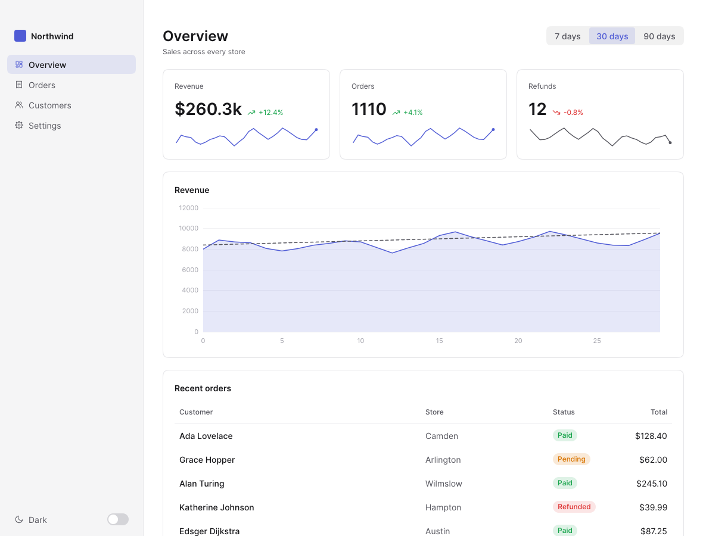
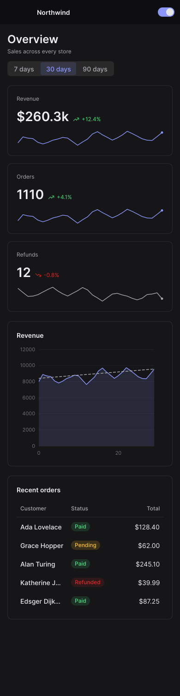
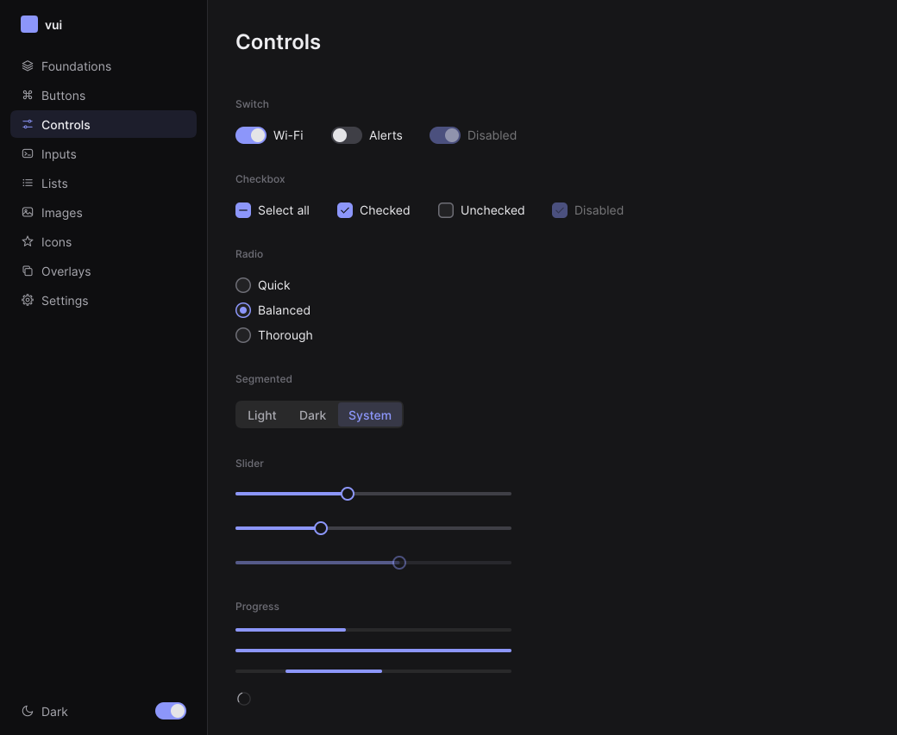
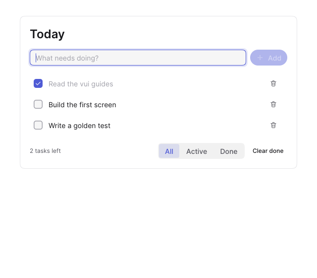

# vui

**A GPU-rendered UI framework for Rust: native apps that look current, adapt to any window size,
and can be tested without a window.**

<p>
  
  
</p>

vui draws every pixel itself, with no web view and no platform widgets underneath. Its parts are:

- a wgpu renderer, with a CPU renderer that matches it;
- a flexbox engine written for interfaces, with responsive rules;
- springs for every motion;
- 70+ widgets and 157 icons;
- charts and graphs;
- an accessibility tree.

Apps are plain Rust: state, messages, and a view.

```rust,no_run
use vui::prelude::*;

#[derive(Clone)]
enum Msg { Add(i32) }

#[derive(Default)]
struct Counter { count: i32 }

impl App for Counter {
    type Msg = Msg;

    fn update(&mut self, msg: Msg, _cx: &mut Cx<Msg>) {
        let Msg::Add(n) = msg;
        self.count += n;
    }

    fn view(&self) -> impl IntoElement<Msg> {
        column().fill().center().gap(16.0).children((
            label(self.count.to_string()).font_size(48.0).weight(600),
            row().gap(8.0).children((
                button("−").on_click(Msg::Add(-1)),
                button("+").primary().on_click(Msg::Add(1)),
            )),
        ))
    }
}

fn main() {
    vui::run(WindowOptions::new("Counter").size(size(360.0, 240.0)), |_| Counter::default()).unwrap();
}
```

## Why vui

- **Modern by default.** The look comes from current design systems:
  - a white sheet on a pale canvas, or dark on darker;
  - one soft indigo accent;
  - pill buttons and continuous corners;
  - Inter type on an 8-point scale;
  - soft shadows, and springs everywhere.

  Light and dark come free, and every token is data you can change.
- **GPU-rendered, with a CPU fallback.**
  - **GPU.** Signed-distance shapes, glyph-atlas text and linear-light mipmapped pictures on wgpu
    (Metal, Vulkan, DirectX 12, GL).
  - **CPU.** With no GPU, such as on a VM, a remote session or CI, the CPU renderer draws the same
    frame from the same maths, to within one level per channel. `VUI_RENDERER=cpu` forces it.
- **Responsive.**
  - `.when(Breakpoint::Compact, |s| s.hidden(true))` restyles any element for a range of window
    widths, without the app tracking sizes or rebuilding its view.
  - Wrapping rows, max-width columns, and tables that drop columns cover the rest.
- **Testable.** `TestUi` clicks, types and moves the clock by hand. Frames compare with golden
  images on the GPU or the CPU, and the accessibility tree can be asserted on.
- **Idle is free.** Frames come only while something moves; a still window costs nothing.
- **Extensible.**
  - **Custom widgets.** Implement one trait.
  - **Custom shaders.** Plug into the renderer as passes.
  - **Themes.** Plain structs.

## Run it

```sh
cargo run -p vui --example hello        # the counter above
cargo run -p vui --example todo         # text input, a list from data, filters, empty state
cargo run -p vui --example dashboard    # sidebar, stat cards, a chart and a table: resize it
cargo run -p gallery --release -- --window   # every widget, light and dark
```

<p>
  
  
</p>

## Use it

vui isn't on crates.io yet. Depend on it by path or git:

```toml
[dependencies]
vui = { git = "https://github.com/harshevo/vui" }   # or { path = "../vui/crates/vui" }
```

`use vui::prelude::*` brings in what a view needs. The rest is under `vui::core`,
`vui::runtime`, `vui::widgets`, `vui::icons`, `vui::viz`, `vui::render`, `vui::testing` and
`vui::platform`.

## Guides

| | |
| --- | --- |
| [Getting started](docs/getting-started.md) | a first app and the examples |
| [The app model](docs/app-model.md) | messages, `Cx` (focus, timers, background work), keys, several windows, overlays, other threads |
| [Layout](docs/layout.md) | flexbox, sizes, scrolling, layers and **responsive layouts** |
| [Styling and theming](docs/styling.md) | tones, decoration, motion, themes and dark mode |
| [Widgets](docs/widgets.md) | the catalogue |
| [Text, icons and images](docs/text-icons-images.md) | type styles, custom fonts, icons, pictures |
| [Charts and graphs](docs/charts.md) | charts, pies and donuts, bar lists, sparklines, force-directed graphs |
| [Custom widgets](docs/custom-widgets.md) | the `Widget` trait, painting, input, custom GPU passes |
| [Rendering](docs/rendering.md) | the GPU and CPU renderers, headless frames, snapshots |
| [Testing](docs/testing.md) | `TestUi`, golden images, CI without a GPU |
| [Accessibility](docs/accessibility.md) | roles, names and keyboard focus |
| [Roadmap](docs/roadmap.md) | what exists, and what comes next |

Every Rust snippet in the guides runs as a doctest, so they stay true to the API.

## What's inside

| Widgets | |
| --- | --- |
| Actions | buttons (primary, secondary, ghost, danger; sizes; icons; loading), icon buttons, segmented controls, keyboard chips |
| Controls | switches, checkboxes (with mixed), radios and radio groups, sliders (range, marked, upright), number inputs |
| Text input | text fields, text areas, search, passwords. One editor behind them: selection, undo, clipboard (text and images), input methods, dictation, emoji |
| Display | labels and titles, markdown, badges, chips, avatars, icons, pictures, cards, separators |
| Data | lists, sortable and responsive tables, trees, lasso selection; line, area, grouped and stacked bar, scatter and candlestick charts, pies and donuts, bar lists, sparklines, graphs |
| Navigation | sidebars, tabs, breadcrumbs, pagination, accordions, disclosures |
| Overlays | tooltips, popovers, dropdown menus, selects, context menus, dialogs, toasts |
| Feedback | progress bars, spinners, alerts, empty states, skeletons, glow, shimmer |
| Effects | linear, radial and conic gradients (fills and borders), aurora, border beam, spotlight |
| Forms | labelled fields, settings rows, section titles |

## Architecture

| Crate | Job |
| --- | --- |
| [`vui`](crates/vui) | the front door: `use vui::prelude::*`, `vui::run`, examples |
| [`vui-core`](crates/vui-core) | geometry, colour, the theme, springs, input events, text shaping, images, the vector engine, and the scene |
| [`vui-runtime`](crates/vui-runtime) | elements and reconciliation, the flexbox engine, responsive rules, input routing, focus, scrolling, animation, accessibility; all headless |
| [`vui-widgets`](crates/vui-widgets) | the standard widgets, by feature: `buttons`, `controls`, `inputs`, `display`, `data`, `navigation`, `overlay`, `feedback`, `layout` |
| [`vui-icons`](crates/vui-icons) | 157 line icons on a 24-point grid, rasterised at any size and weight |
| [`vui-viz`](crates/vui-viz) | scales, charts, pies, bar lists, sparklines and force-directed graphs |
| [`vui-render`](crates/vui-render) | the wgpu renderer, the CPU renderer, custom passes, headless rendering and golden-image tests |
| [`vui-macos`](crates/vui-macos) | the macOS backend: windows, overlays, input method, clipboard, cursors, display-link frames, `Proxy` |
| [`vui-fonts`](crates/vui-fonts) | Inter and JetBrains Mono, bundled (SIL OFL 1.1) |
| [`examples/gallery`](examples/gallery) | every widget as an app; its pages are golden images |

Each crate is split by feature, and no source file is over 500 lines.

## Platforms

| | Status |
| --- | --- |
| macOS | windows, overlays and everything above |
| Windows, Linux | the runtime, widgets and both renderers build and run headless (tests, CI, screenshots); the window backend is on the [roadmap](docs/roadmap.md) |

## Tests

```sh
cargo test --workspace                     # 900+ tests: behaviour, layout, golden frames, doctests
VUI_RENDERER=cpu cargo test --workspace    # the same golden frames drawn by the CPU renderer
VUI_BLESS=1 cargo test --workspace         # re-bless golden images after an intended change
```

A failing golden comparison writes the frame and a highlighted diff to the crate's
`tests/actual`. Look at both before re-blessing.

```sh
cargo bench -p vui --bench frame           # layout, paint and CPU-render timings
```

CI runs clippy, the tests on the GPU and CPU renderers, the minimum Rust version (1.91) and the
docs on every push. See [CONTRIBUTING.md](CONTRIBUTING.md) for the house rules and
[CHANGELOG.md](CHANGELOG.md) for what changed.

## Status

vui is young but solid: the renderer, runtime, widgets and macOS backend are used every day by
vmac, its first app (a voice-first Mac assistant), and are covered by tests. The next steps are the
VoiceOver bridge, Windows and Linux backends, virtualised lists, grid layout and more widgets. See
the [roadmap](docs/roadmap.md).

**Licence:** none has been chosen yet. The bundled fonts are under the SIL Open Font License 1.1.
